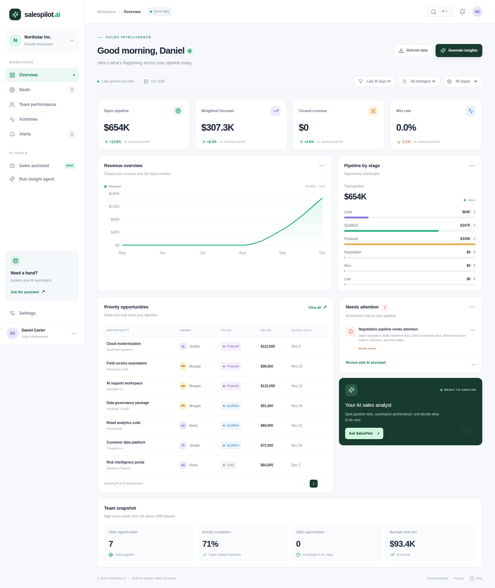
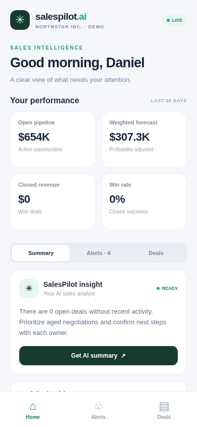

# SalesPilot AI

AI-assisted sales operations prototype: Next.js web dashboard, Express REST API, Expo mobile UI, deterministic KPI/alert agent loop, optional LLM summaries, and PostgreSQL schema foundation.

> Demo mode: data is synthetic. API run history is currently in-memory and resets on restart. SQL schema is a foundation, not yet wired to API persistence. Mobile alerts are in-app (push delivery is not configured). Do not connect sensitive CRM data before adding authentication, tenant isolation, secure tokens, and audit logs.

## Screenshots

These screenshots are captured from the running applications by the GitHub Actions screenshot workflow (not mockups).

### Web dashboard



### Mobile app (Expo / React Native)




## Architecture

- **Web:** Next.js, TypeScript, Tailwind CSS, Recharts
- **Mobile:** Expo / React Native, shared REST API
- **API:** Express, TypeScript, Zod validation
- **Agent:** Custom inspectable loop: fetch CRM records -> calculate KPIs -> detect stale deals and pipeline risk -> optionally generate a grounded LLM narrative -> record run result
- **Data:** synthetic CRM adapter by default; PostgreSQL schema in `infra/db/init.sql`
- **Future RAG:** pgvector document chunks for lost-deal analysis, similar account discovery, meeting prep, and internal-document Q&A.

The prototype uses a custom loop for transparent deterministic rules; LangGraph can be added later if workflows need durable state, complex branching, retries, or human approvals.

## Run locally

Requirements: Node.js 20+ and npm 10+.

```bash
npm install
cp apps/api/.env.example apps/api/.env
npm run dev
```

Web: http://localhost:3000  
API health: http://localhost:4000/health

Mobile: `npm run dev:mobile`. For a physical device, set `EXPO_PUBLIC_API_URL` in `apps/mobile/.env` to your computer's LAN address rather than localhost.

Commands: `npm run dev:web`, `npm run dev:api`, `npm run typecheck`, `npm run build:web`.

## Environment

See `apps/api/.env.example`. Without an LLM key the deterministic narrative works. To enable an OpenAI-compatible chat-completions endpoint, set `LLM_API_KEY`, `LLM_BASE_URL`, and `LLM_MODEL`. Never commit secrets.

## API

See [API guide](docs/API.md) for routes. Main endpoints: `GET /api/dashboard`, `GET /api/kpis`, `GET /api/alerts`, `GET /api/crm/deals`, `GET /api/crm/contacts`, `GET /api/crm/activities`, `POST /api/agent/run`, `GET /api/agent/runs`, and `POST /api/chat`.

## Agent example

1. Load deals, contacts, and activities through a CRM adapter.
2. Compute pipeline, probability-weighted forecast, closed revenue, win rate, activity completion, and stale deal count.
3. Evaluate deterministic alert thresholds and attach relevant deal evidence.
4. Optionally ask the configured LLM to summarize supplied metrics only.
5. Return KPIs, alerts, narrative, and step-by-step trace to both clients.

Future production work: real CRM OAuth connectors, auth/RBAC, durable PostgreSQL + Redis/BullMQ jobs, model usage safeguards, alerts delivery, tests/observability, and pgvector RAG with source metadata.
